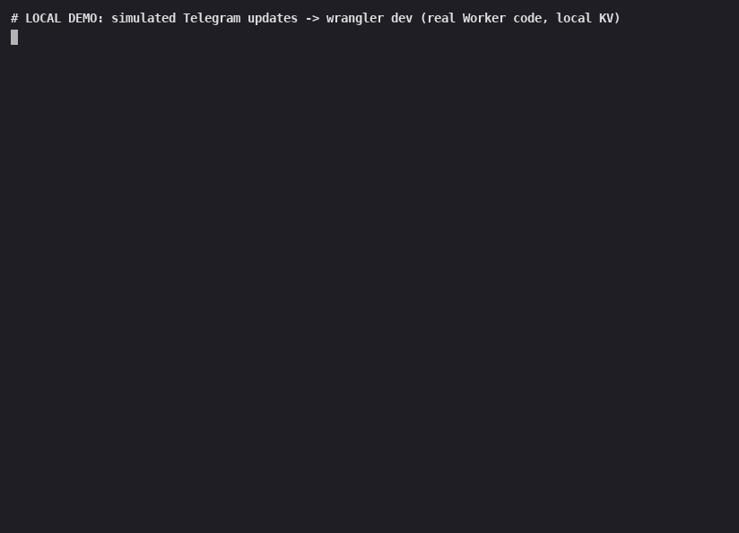

# feed-watch-bot

A tiny **Telegram alert bot that runs on Cloudflare Workers**. No server to rent, nothing to keep online.

Every 15 minutes a **Cron Trigger** checks your RSS / Atom feeds (fixed list + feeds you add
with `/watch`), remembers what it has already seen in **Workers KV**, and posts each new item
to your **Telegram** chat. Chat commands arrive through a **webhook**.



*LOCAL DEMO (not a real Telegram screen). Simulated webhook updates hit `wrangler dev`;
the replies are captured by a local mock of the Telegram Bot API. Recording:
[`docs/demo.cast`](docs/demo.cast), script: `scripts/local-demo/`.*

```
 Telegram chat ──webhook──▶ Worker ──▶ Workers KV (feeds + seen ids)
                               │
 Cron Trigger (every 15 min) ──┘──▶ RSS/Atom feeds ──▶ Telegram sendMessage
```

## Features

- Chat commands: `/watch <url>`, `/list`, `/remove <id>`, `/rate USD EUR`, `/help`.
- Watches **RSS 2.0, RSS 1.0 (RDF) and Atom** feeds: a fixed list in `wrangler.toml` plus feeds
  added with `/watch` (stored per chat in KV, max `MAX_FEEDS_PER_CHAT`).
- **Only your chat** is answered (`TELEGRAM_CHAT_ID`). The webhook secret is checked on every update.
- `/watch` validates the URL (http(s) only, no credentials, no private/local hosts, size + timeout
  capped) and marks existing items as seen, so only items published from now on are posted.
- `/rate` uses the public [Frankfurter](https://www.frankfurter.app/) API (ECB reference rates).
- **No duplicates:** seen ids are stored per feed in KV; KV is only written when something changed.
- Posts oldest first, at most `MAX_ITEMS_PER_FEED` per feed per run, with a pause between messages;
  retries once on HTTP 429. A broken feed is skipped; a mid-run Telegram failure keeps the
  items that were already delivered.
- **Secrets stay secret:** token, chat id and webhook secret are Wrangler secrets, never in the
  code or in logs.
- Offline unit tests with Node's built-in test runner (`npm test`), no network needed.

## What you need

- A free **Cloudflare account** (your own).
- A **Telegram bot token** from [@BotFather](https://t.me/BotFather) (your own bot).
- **Node.js 22+** on your computer (Wrangler 4 requires it).

## Setup, step by step

### 1. Get the code and install

```bash
git clone <this-repo-url> feed-watch-bot
cd feed-watch-bot
npm install
npm test            # optional: runs the offline tests
```

### 2. Create your Telegram bot

1. In Telegram, open **@BotFather** and send `/newbot`. Choose a name and a username.
2. BotFather replies with a **token** like `123456789:AA...`. Keep it private.
3. Add the bot to the chat where alerts should go:
   - **Private chat:** open your bot and press **Start**.
   - **Group:** add the bot to the group.
   - **Channel:** add the bot as an **administrator** with permission to post.
4. Find the **chat id**: send a message in that chat (in a channel, post something), then open
   `https://api.telegram.org/bot<YOUR_TOKEN>/getUpdates` in your browser and look for
   `"chat":{"id": ...}`. Group and channel ids are negative numbers (e.g. `-100...`).
   For a public channel you can also use its `@channelusername`.

### 3. Log in to Cloudflare from Wrangler

```bash
npx wrangler login      # opens your browser; approve access for your own account
npx wrangler whoami     # check you are on the right account
```

### 4. Create the KV namespace

```bash
npx wrangler kv namespace create SEEN
```

Copy the `id` it prints into `wrangler.toml`, replacing `REPLACE_WITH_YOUR_KV_NAMESPACE_ID`.

### 5. Choose your feeds

Edit `[vars]` in `wrangler.toml`:

```toml
FEEDS = """
https://github.com/cloudflare/workers-sdk/releases.atom
https://example.com/blog/rss.xml
"""
```

Optional settings: `MAX_ITEMS_PER_FEED`, `POST_ON_FIRST_RUN`, `SEND_DELAY_MS`, and the schedule in
`[triggers] crons` (cron times are UTC).

### 6. Add your secrets

```bash
npx wrangler secret put TELEGRAM_BOT_TOKEN       # BotFather token
npx wrangler secret put TELEGRAM_CHAT_ID         # your chat / group / channel id
npx wrangler secret put TELEGRAM_WEBHOOK_SECRET  # any long random string you invent
```

They are stored encrypted in your Cloudflare account. You can also add them in the dashboard
under *Workers & Pages → feed-watch-bot → Settings → Variables and Secrets* (type **Secret**).

### 7. Deploy and register the webhook

```bash
npx wrangler deploy
# Register the webhook + the command menu. Uses the Worker URL from the deploy output:
curl -X POST "https://feed-watch-bot.<your-subdomain>.workers.dev/setup" \
  -H "X-Setup-Key: <same TELEGRAM_WEBHOOK_SECRET>"
```

That's it. Open your bot in Telegram and try `/watch https://github.com/cloudflare/workers-sdk/releases.atom`.
The cron runs every 15 minutes. Watch live logs with `npx wrangler tail`.

The first check of a feed only records existing items. Wait for a new item, or set
`POST_ON_FIRST_RUN = "true"` once if you want messages immediately.

## Test locally

```bash
cp .dev.vars.example .dev.vars        # put a TEST bot token, chat id and webhook secret (git-ignored)
npm run dev                           # wrangler dev --test-scheduled
curl "http://localhost:8787/__scheduled?cron=*/15+*+*+*+*"   # trigger one cron run
```

**Local demo without a real bot** (what the GIF above shows): a mock Telegram API + simulated
webhook updates exercise the real Worker code and local KV.

```bash
scripts/local-demo/start.sh           # mock on :8788 + wrangler dev on :8799
scripts/local-demo/send.sh "/help"    # simulated Telegram message
scripts/local-demo/steps.sh           # the full recorded sequence
scripts/local-demo/stop.sh
```

## Configuration reference

| Name | Where | Default | Meaning |
|---|---|---|---|
| `TELEGRAM_BOT_TOKEN` | secret | (required) | Token from @BotFather |
| `TELEGRAM_CHAT_ID` | secret | (required) | Chat, group or channel answered by the bot |
| `TELEGRAM_WEBHOOK_SECRET` | secret | (required) | Random string; Telegram header + `/setup` key |
| `FEEDS` | `[vars]` | one example feed | Fixed feed URLs, one per line (commas also work) |
| `MAX_ITEMS_PER_FEED` | `[vars]` | `5` | Max new items posted per feed per run |
| `MAX_FEEDS_PER_CHAT` | `[vars]` | `10` | Max feeds a chat may add with `/watch` |
| `POST_ON_FIRST_RUN` | `[vars]` | `false` | Post existing items on the first check of a feed |
| `SEND_DELAY_MS` | `[vars]` | `1100` | Pause between Telegram messages |
| `SEEN` | KV binding | (required) | Seen item ids + per-chat watch lists |
| `crons` | `[triggers]` | `*/15 * * * *` | Schedule (UTC) |

## Free plan notes

A few feeds every 15 minutes is a small workload: 96 cron runs a day, and at most one KV write
per feed per run (only when the feed has new items). Check Cloudflare's current
[Workers limits](https://developers.cloudflare.com/workers/platform/limits/) and
[KV limits](https://developers.cloudflare.com/kv/platform/limits/) before adding many feeds or
running more often.

## Project layout

```
src/index.js      Worker entry (default export only: fetch + scheduled)
src/app.js        webhook, /setup, cron runOnce
src/commands.js   /watch /list /remove /rate /help
src/store.js      per-chat watch lists in KV
src/validate.js   feed URL + currency validation
src/feed.js       RSS / Atom / RDF parsing + download
src/dedupe.js     KV "seen" bookkeeping and new-item selection
src/telegram.js   sendMessage / setWebhook with HTML escaping and 429 retry
scripts/local-demo/  local demo without a real Telegram bot
test/             node:test unit tests + XML fixtures
wrangler.toml     Worker name, cron, KV binding, feed list
```

## Scope

- Sends to **Telegram only**.
- Runs on **your own** Cloudflare account with **your own** bot token; the developer never needs
  your password or token. You create the Cloudflare account and the BotFather token yourself.
- Bug fixes for 7 days after delivery are included in the gig. Maintenance after that is not included
  (available as a separate order).

## Hire me

Need a custom Telegram alert bot that runs on your own Cloudflare account? Order on Fiverr:
**FIVERR_GIG_URL** <!-- PLACEHOLDER: replace with the real Fiverr gig link once the gig is live -->

## License

[MIT](LICENSE)
